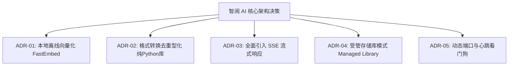
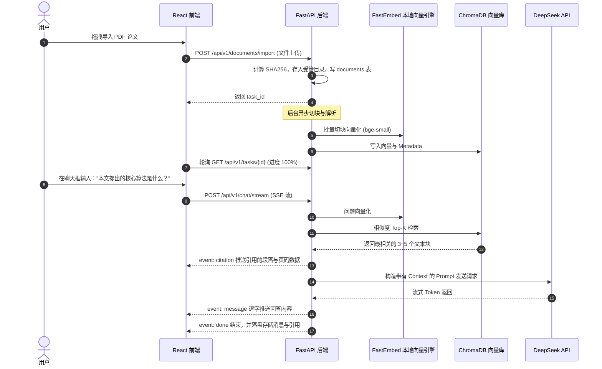
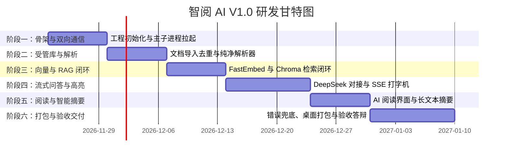

# 《智阅 AI——个人智能文档处理与知识管理系统》
## V1.0 综合设计与开工执行方案（优化终版）

> **版本**：V1.0-Optimized  
> **更新时间**：2026年11月  
> **文档定位**：本项目集《总体方案》、《产品需求说明书 (PRD)》与《系统技术架构设计书》之精髓，融入工程落地、避坑策略与开发裁剪优化，作为项目开发、接口契约及验收的唯一基准技术规范。

---

## 目录
1. [项目定位与设计原则](#一-项目定位与设计原则)
2. [关键架构决策记录 (ADR)——避坑核心](#二-关键架构决策记录-adr避坑核心)
3. [系统整体技术架构](#三-系统整体技术架构)
4. [数据库与存储设计 (SQLite + ChromaDB)](#四-数据库与存储设计-sqlite--chromadb)
5. [核心业务流与 API 接口契约](#五-核心业务流与-api-接口契约)
6. [工程项目结构与环境规范](#六-工程项目结构与环境规范)
7. [开工实施路线图与阶段交付标准](#七-开工实施路线图与阶段交付标准)

---

## 一、 项目定位与设计原则

### 1.1 项目定位
**智阅 AI (Zhiyue AI)** 是一款**本地优先（Local-First）的个人智能文档工作站**。它不仅是文档查看器，更是个人桌面级外脑知识库。通过融合本地向量嵌入（Embedding）、大语言模型（LLM）与检索增强生成（RAG）技术，帮助用户在本地安全管理、深度阅读、问答检索 PDF、DOCX、TXT、Markdown 等资料。

### 1.2 核心设计原则
1. **本地优先，隐私可控（Local-First & Privacy）**：用户导入的原始文档、解析提取的全文数据、向量数据库全部落盘在用户本地机器。非必要绝不向远程发送数据；调用云端 LLM 时需明确告知传输范围。
2. **轻量自洽，拒绝臃肿（Self-Contained & Lightweight）**：严控外部重型系统依赖，拒绝捆绑数百兆的非必要应用组件（如 LibreOffice、TeX 引擎等），保持桌面客户端轻快、纯粹。
3. **交互无卡顿（Real-Time Streaming UX）**：AI 问答与长文本生成全面采用 Server-Sent Events (SSE) 流式传输，首字响应毫秒级，杜绝长时间 Loading 阻塞。
4. **结论有据可查（Verifiable Citations）**：AI 针对知识库的所有回答，均强制关联检索到的原文段落与源文件页码，并在前端实现一键定位联动。

---

## 二、 关键架构决策记录 (ADR)——避坑核心

针对初期规划中容易引发“打包烂尾”、“依赖崩塌”和“交互卡死”的技术暗坑，明确以下五项核心架构决议：



### ADR-01：向量化（Embedding）采用本地轻量 FastEmbed
* **背景**：DeepSeek 官方 API 仅提供 `deepseek-chat` / `deepseek-reasoner` 模型，**无公开发布的 Embedding API**。若强制要求用户配置第三方商业 Embedding Key，极大增加使用门槛。
* **决议**：V1.0 统一采用 Python **`fastembed`** 库，内置 **`BAAI/bge-small-zh-v1.5`**（ONNX 格式）。
* **优势**：
  * 模型大小仅约 90MB，无需笨重的 PyTorch 运行库。
  * 在 Apple Silicon (M系列芯片) 及普通 CPU 上运行极快（毫秒级切块推理）。
  * 纯离线运行，切块无需外发，真正践行“本地优先”。

### ADR-02：格式转换“去重型化”，剔除 LibreOffice 与 Pandoc
* **背景**：原方案计划支持 DOCX $\rightarrow$ PDF 和 Markdown $\rightarrow$ PDF，指定依赖 LibreOffice（体积约 800MB）和 Pandoc（转 PDF 需外挂数 GB 的 LaTeX 引擎）。打包进客户端或强制要求用户安装都会引发极高故障率。
* **决议**：V1.0 果断剥离 LibreOffice 和 Pandoc 依赖，将格式转换聚焦于“为知识入库与纯净文本导出服务”：
  * **PDF $\rightarrow$ Markdown / TXT**：由纯 Python 的 `PyMuPDF` 提取。
  * **DOCX $\rightarrow$ Markdown / TXT**：由纯 Python 的 `python-docx` / `mammoth` 提取。
  * **TXT $\leftrightarrow$ Markdown**：内置正则与文本处理。
  * 放弃 V1.0 的 DOCX/MD $\rightarrow$ PDF 渲染导出，规避庞大的外部排版引擎。

### ADR-03：问答与长文档总结全面引入 SSE 流式传输
* **背景**：原方案设计为常规 POST 同步请求。大模型生成几百字通常需要 5~15 秒，导致前端长时间呈现白屏转圈，交互极差。
* **决议**：
  * 后端问答接口使用 FastAPI `StreamingResponse` 提供 Server-Sent Events (SSE) 输出。
  * **两阶段推流**：第一帧推送本次检索命中的文档来源引用信息（Citations JSON），后续帧逐字推送 LLM 生成的 Markdown 文本流，实现平滑打字机效果。

### ADR-04：采用受管存储库模式（Managed Storage），废弃“纯绝对路径引用”
* **背景**：如果仅记录外部文件路径，一旦用户在“下载”目录移动、重命名或删除了原文件，知识库立即失效；且在 macOS 沙盒机制下易出现权限丢失。
* **决议**：用户导入文件时，系统计算其 **SHA256 哈希值**。若哈希已存在则直接关联；若不存在，则将文件复制到应用本地受管数据目录 `~/Library/Application Support/ZhiyueAI/storage/{hash}_{filename}` 中。保证用户文件永不丢失，切块溯源永不失效。

### ADR-05：端口动态分配 + Token 鉴权 + 父进程看门狗机制
* **背景**：Electron + Python 桌面开发最常出现“固定 8000 端口冲突”以及“Electron 退出后 Python 后端未退出成为僵尸进程”。
* **决议**：
  1. Python 启动时绑定 `127.0.0.1:0`，由系统分配空闲随机端口。
  2. 启动时生成单次运行临时会话 Token，后端通过 `stdout` 发送 `SERVER_READY:port=XXXX:token=YYYY`，Electron 捕获后注入渲染层。
  3. Python 后端启动独立守护线程：定时检测父进程（Electron 主进程 PID）是否存在，一旦父进程退出，Python 立即自杀结束，根除孤儿进程。

---

## 三、 系统整体技术架构

### 3.1 分层架构示意图
```
┌────────────────────────────────────────────────────────┐
│                   桌面端展示与控制层                    │
│     Electron 28+ Shell  +  React 18  +  TypeScript    │
│  (TailwindCSS + AntD / Lucide-React + Zustand 状态管理) │
└──────────────────────────┬─────────────────────────────┘
                           │ 本地 HTTP / SSE (带临时 Token)
┌──────────────────────────▼─────────────────────────────┐
│                 Python FastAPI 后端核心                 │
│  ┌──────────────────────────────────────────────────┐  │
│  │ 路由控制层 (API Routes / Pydantic V2 Schemas)     │  │
│  ├──────────────────────────────────────────────────┤  │
│  │ 业务服务层 (Documents / Parsers / RAG / Summary) │  │
│  ├──────────────────────────────────────────────────┤  │
│  │ 模型接入层 (BaseLLMProvider -> DeepSeek / OpenAI)│  │
│  │ 向量嵌入层 (FastEmbed / bge-small-zh-v1.5)       │  │
│  └──────────────────────────────────────────────────┘  │
└────────────┬─────────────────────────────┬─────────────┘
             │                             │
┌────────────▼────────────┐   ┌────────────▼─────────────┐
│       数据与索引持久化    │   │      外部 AI 模型网关      │
│  - SQLite (元数据/消息)   │   │  - DeepSeek API          │
│  - ChromaDB (段落向量)   │   │    (deepseek-chat)       │
│  - Managed Local Storage│   │  - OpenAI Compatible API │
└─────────────────────────┘   └──────────────────────────┘
```

### 3.2 核心技术栈清单
* **桌面端**：Electron 28+, React 18, TypeScript, Vite, Zustand, TailwindCSS, Axios / Fetch EventSource.
* **后端**：Python 3.10+, FastAPI, Uvicorn, Pydantic V2, SQLAlchemy 2.0 (Async / Sync), PyMuPDF (fitz), python-docx.
* **AI & 向量引擎**：FastEmbed (`bge-small-zh-v1.5`), ChromaDB (PersistentClient), DeepSeek API (兼容 OpenAI SDK).
* **持久化**：SQLite 3, 本地文件系统.

---

## 四、 数据库与存储设计 (SQLite + ChromaDB)

本地数据库位于：`~/Library/Application Support/ZhiyueAI/database/zhiyue.db`

### 4.1 SQLite 核心数据表结构 (DDL)

```sql
-- 1. 文档主表
CREATE TABLE documents (
    id TEXT PRIMARY KEY,                       -- UUID
    name TEXT NOT NULL,                        -- 原始文件名
    file_type TEXT NOT NULL,                   -- pdf, docx, txt, md
    file_size INTEGER NOT NULL,                -- 字节大小
    file_hash TEXT NOT NULL UNIQUE,            -- SHA-256 哈希值 (防重复)
    storage_path TEXT NOT NULL,                -- 内部受管存储实际相对/绝对路径
    page_count INTEGER DEFAULT 0,              -- 总页数 (PDF有效)
    char_count INTEGER DEFAULT 0,              -- 总字符数
    status TEXT NOT NULL DEFAULT 'pending',    -- pending, parsing, indexed, failed
    error_message TEXT,                        -- 失败原因
    created_at DATETIME DEFAULT CURRENT_TIMESTAMP,
    updated_at DATETIME DEFAULT CURRENT_TIMESTAMP
);

-- 2. 文档段落切块表 (与向量库一一对应，用于快速全文溯源)
CREATE TABLE document_chunks (
    id TEXT PRIMARY KEY,                       -- chunk 唯一 ID (形如 docid_chunkindex)
    document_id TEXT NOT NULL,                 -- 关联 documents.id
    chunk_index INTEGER NOT NULL,              -- 块序列号
    page_number INTEGER,                       -- 所在物理页码 (从1开始)
    section_title TEXT,                        -- 所属段落/章节标题
    content TEXT NOT NULL,                     -- 切块文本正文
    char_length INTEGER NOT NULL,              -- 文本字符长度
    created_at DATETIME DEFAULT CURRENT_TIMESTAMP,
    FOREIGN KEY(document_id) REFERENCES documents(id) ON DELETE CASCADE
);
CREATE INDEX idx_chunks_doc ON document_chunks(document_id);

-- 3. 对话会话表
CREATE TABLE conversations (
    id TEXT PRIMARY KEY,                       -- UUID
    document_id TEXT NOT NULL,                 -- 关联的单文档 ID (V1.0)
    title TEXT NOT NULL,                       -- 会话标题 (默认取第一句或文档名)
    created_at DATETIME DEFAULT CURRENT_TIMESTAMP,
    updated_at DATETIME DEFAULT CURRENT_TIMESTAMP,
    FOREIGN KEY(document_id) REFERENCES documents(id) ON DELETE CASCADE
);

-- 4. 消息记录表 (含引用片段)
CREATE TABLE messages (
    id TEXT PRIMARY KEY,                       -- UUID
    conversation_id TEXT NOT NULL,             -- 关联 conversations.id
    role TEXT NOT NULL,                        -- user / assistant / system
    content TEXT NOT NULL,                     -- 消息内容 (支持 Markdown)
    citations_json TEXT,                       -- 引用的原文信息数组 JSON [ {chunk_id, page, text, score} ]
    created_at DATETIME DEFAULT CURRENT_TIMESTAMP,
    FOREIGN KEY(conversation_id) REFERENCES conversations(id) ON DELETE CASCADE
);

-- 5. 文档摘要与脑图提取表
CREATE TABLE summaries (
    id TEXT PRIMARY KEY,                       -- UUID
    document_id TEXT NOT NULL,                 -- 关联 documents.id
    summary_type TEXT NOT NULL,                -- overall(全文综述), keypoints(核心观点), outline(大纲)
    content TEXT NOT NULL,                     -- 摘要结果 (Markdown)
    created_at DATETIME DEFAULT CURRENT_TIMESTAMP,
    FOREIGN KEY(document_id) REFERENCES documents(id) ON DELETE CASCADE
);

-- 6. 异步任务表 (用于前端轮询导入解析与长文本处理进度)
CREATE TABLE async_tasks (
    id TEXT PRIMARY KEY,                       -- 任务 ID
    task_type TEXT NOT NULL,                   -- doc_parse, doc_index, doc_summary, format_convert
    target_id TEXT,                            -- 关联对象 ID (如 document_id)
    status TEXT NOT NULL,                      -- pending, running, success, failed
    progress INTEGER DEFAULT 0,                -- 进度 0 ~ 100
    result_json TEXT,                          -- 成功结果摘要
    error_message TEXT,                        -- 失败错误信息
    created_at DATETIME DEFAULT CURRENT_TIMESTAMP,
    updated_at DATETIME DEFAULT CURRENT_TIMESTAMP
);

-- 7. 模型与系统配置表
CREATE TABLE app_settings (
    key TEXT PRIMARY KEY,                      -- 配置键 (如 llm_provider, deepseek_api_key, api_base_url, model_name)
    value TEXT NOT NULL,                       -- 配置值
    is_encrypted INTEGER DEFAULT 0,            -- 是否简单混淆/保护存储
    updated_at DATETIME DEFAULT CURRENT_TIMESTAMP
);
```

### 4.2 ChromaDB 向量集合设计
* **Collection 名称**：`zhiyue_knowledge_base`
* **Embedding Function**：FastEmbed (`bge-small-zh-v1.5`)
* **Metadata 规范**：
  ```json
  {
    "document_id": "doc_uuid_xxx",
    "chunk_id": "chunk_uuid_xxx",
    "page_number": 3,
    "section_title": "第 2.1 节 总体架构"
  }
  ```

---

## 五、 核心业务流与 API 接口契约

### 5.1 核心业务链路时序图



### 5.2 核心 API 规范

#### 1. 文档管理模块
* **POST `/api/v1/documents/import`**
  * 请求：`multipart/form-data`，包含 `file`。
  * 响应：`{ "task_id": "task_xxx", "document_id": "doc_xxx", "status": "pending" }`
* **GET `/api/v1/documents`**
  * 响应：文档列表，含解析状态、字符数、页数、导入时间。
* **DELETE `/api/v1/documents/{id}`**
  * 联动：同时清理受管目录文件、SQLite 记录、ChromaDB 对应 `document_id` 的向量记录。

#### 2. 问答流式模块 (SSE)
* **POST `/api/v1/chat/stream`**
  * 请求体：
    ```json
    {
      "conversation_id": "conv_xxx",
      "document_id": "doc_xxx",
      "question": "文章的核心结论是什么？",
      "history_limit": 3
    }
    ```
  * 响应类型：`text/event-stream`
  * 事件结构：
    * `event: citations`：`data: [{"chunk_id": "...", "page": 4, "text": "...", "score": 0.85}]`
    * `event: token`：`data: {"delta": "本"}`
    * `event: error`：`data: {"code": "MODEL_ERROR", "msg": "API Key 额度不足"}`
    * `event: done`：`data: {"message_id": "msg_xxx"}`

#### 3. 智能总结与长文档处理模块
* **POST `/api/v1/reader/{id}/summarize`**
  * 请求体：`{ "mode": "overall" | "outline" | "keypoints" }`
  * 策略：对于字数 > 15,000 的长文档，后台启动分块聚合（Map-Reduce）异步任务，返回 `task_id`，避免超时。

#### 4. 模型配置模块
* **POST `/api/v1/settings/model/test`**
  * 请求体：`{ "provider": "deepseek", "base_url": "https://api.deepseek.com", "api_key": "sk-xxx", "model_name": "deepseek-chat" }`
  * 响应：`{ "success": true, "latency_ms": 320 }`

---

## 六、 工程项目结构与环境规范

统一采用 Monorepo 目录规范：

```
zhiyue-ai/
├── apps/
│   └── desktop/                   # Electron + React 前端工程
│       ├── electron/
│       │   ├── main.ts            # 主进程：窗口管理、子进程拉起、心跳捕获
│       │   └── preload.ts         # Preload：受限暴露系统级 API
│       ├── src/
│       │   ├── api/               # Axios 与 SSE 客户端封装
│       │   ├── components/        # 通用组件 (Sidebar, Modal, Loading)
│       │   ├── pages/             # 核心页面 (Home, Library, Reader, Chat, Settings)
│       │   ├── stores/            # Zustand 状态 (文档库、当前对话、配置状态)
│       │   └── App.tsx
│       ├── package.json
│       └── vite.config.ts
│
├── backend/                       # Python FastAPI 后端核心
│   ├── app/
│   │   ├── api/
│   │   │   ├── routes/            # documents.py, chat.py, reader.py, settings.py
│   │   │   └── deps.py
│   │   ├── core/
│   │   │   ├── config.py          # 路径配置、动态端口与密钥管理
│   │   │   ├── watchdog.py        # 父进程心跳看门狗
│   │   │   └── security.py
│   │   ├── database/
│   │   │   ├── session.py         # SQLite 连接管理
│   │   │   └── models.py          # SQLAlchemy ORM
│   │   ├── parsers/               # 纯文本解析适配器
│   │   │   ├── pdf_parser.py      # PyMuPDF 纯净文本及分页提取
│   │   │   ├── docx_parser.py     # python-docx 提取
│   │   │   └── txt_parser.py
│   │   ├── services/
│   │   │   ├── rag_service.py     # 切块、FastEmbed、ChromaDB 交互
│   │   │   ├── llm_service.py     # 统一 LLM 适配器 (DeepSeek/OpenAI 流式)
│   │   │   └── document_service.py
│   │   └── main.py                # 后端入口
│   ├── requirements.txt           # 核心依赖清单
│   └── pyproject.toml
│
├── docs/                          # 项目架构与设计文档
├── scripts/
│   ├── dev.sh                     # 一键启动开发环境 (FastAPI + Vite + Electron)
│   └── build.sh                   # 打包构建脚本
└── README.md
```

### 关键 Python 依赖基线 (`requirements.txt`)
```txt
fastapi>=0.109.0
uvicorn>=0.27.0
pydantic>=2.6.0
sqlalchemy>=2.0.25
chromadb>=0.4.22
fastembed>=0.2.2
pymupdf>=1.23.8
python-docx>=1.1.0
httpx>=0.26.0
openai>=1.12.0
```

---

## 七、 开工实施路线图与阶段交付标准

建议整体研发周期划分为 **6 个阶段（共 6~8 周）**。严格坚持“敏捷推进、步步验证、小步快跑”的原则：



### 阶段一：基础脚手架与主子进程双向通信（第 1 周）
* **核心目标**：搭好骨架，打通 Electron 与 Python FastAPI 协同。
* **具体任务**：
  1. 初始化 Monorepo，配置 React+Vite 前端与 Python 虚拟环境。
  2. 实现 Electron 主进程启动 Python 后端子进程，监听随机端口 `port=0`。
  3. Python 后端通过 stdout 握手上报 `SERVER_READY:port=XXXX:token=YYYY`。
  4. 实现 Python 内部看门狗机制（Electron 主窗口关闭，Python 进程自动销毁）。
* **阶段验收标准**：
  * 运行 `npm run dev` 能一键拉起桌面窗口，前端能成功调用后端的 `/api/v1/health` 获得 HTTP 200 状态。

### 阶段二：受管文档库与本地解析器（第 2 周）
* **核心目标**：实现本地文档的受控导入与纯文本高质量抽取。
* **具体任务**：
  1. 初始化 SQLite 数据库与数据表。
  2. 实现文件拖拽选择，后端计算 SHA-256 并复制到受管存储目录。
  3. 编写 `pdf_parser.py`（基于 PyMuPDF），提取文本同时保留物理页码信息。
  4. 编写 `docx_parser.py`、`txt_parser.py`。
* **阶段验收标准**：
  * 用户拖入一份 50 页的 PDF 和一份 DOCX，文档库正确显示文件列表、页数、大小，且无法重复导入相同哈希文件。

### 阶段三：FastEmbed 向量化与 RAG 检索链路（第 3 周）
* **核心目标**：完全离线完成文本切块、向量计算与相似度检索。
* **具体任务**：
  1. 集成 `fastembed`，实现按段落递归切块（块大小 500~800 字符，重叠 100 字符）。
  2. 切块写入 SQLite `document_chunks` 表，并携带 metadata 写入 ChromaDB。
  3. 编写 RAG 检索器单元测试：给定自然语言查询，返回 Top-K 关联度最高的文本块。
* **阶段验收标准**：
  * 在命令行或自动化测试中，输入针对导入 PDF 的问题，ChromaDB 能在 100ms 内准确返回包含答案的那几段原文与对应页码。

### 阶段四：DeepSeek 接入、SSE 流式问答与前端高亮（第 4~5 周）
* **核心目标**：实现最核心的“AI 对话 + 来源可查”体验。
* **具体任务**：
  1. 封装 `BaseLLMProvider`，接入 DeepSeek API。
  2. 构造 RAG 提示词模板（注入检索片段，严格约束“仅根据给定材料回答，无依据时直接坦白”）。
  3. 实现 FastAPI `POST /api/v1/chat/stream`，支持 SSE 协议输出。
  4. 前端使用 `@microsoft/fetch-event-source` 渲染打字机流式输出。
  5. 点击引用标签（Citation Badge），自动展示来源原文字句与所在页码。
* **阶段验收标准**：
  * 针对已导入的论文提问，AI 实时逐字回复，并在回复下方清晰展示“引用来源：第 X 页，片段摘要”，无卡顿感。

### 阶段五：AI 阅读器与长文档智能摘要（第 6 周）
* **核心目标**：实现文档分栏阅读与一键生成摘要。
* **具体任务**：
  1. 前端实现左右分栏布局（左侧目录/分页文本，右侧 AI 助手面板）。
  2. 后端实现长文本摘要：采用分层递归/Map-Reduce 策略，生成“全文概要”、“核心论点”与“结构大纲”。
  3. 设置页面：支持用户动态修改 DeepSeek API Key 并进行网络连通性测试。
* **阶段验收标准**：
  * 点击“生成摘要”按钮，大文档能在后台稳定生成结构化概要并持久化保存，再次打开即刻加载。

### 阶段六：容错兜底、桌面打包与验收演练（第 7~8 周）
* **核心目标**：消除边缘 Bug，产出可独立分发的应用安装包。
* **具体任务**：
  1. 完善全链路错误提示：无网络、API 欠费、格式损坏、文件过大等情况均有友好弹窗。
  2. 配置 PyInstaller 与 `electron-builder`，实现 macOS (.dmg) 打包。
  3. 准备 2 份标准演示文档（一份专业 PDF 论文，一份 DOCX 方案），录制演示视频并准备答辩材料。
* **阶段验收标准**：
  * 在未配置 Python 开发环境的纯净 macOS 机器上，双击智阅 AI 应用能正常启动并顺畅跑通完整演示流程。

---

> **结语**：优化后的方案砍掉了不切实际的外部依赖，补齐了本地离线 Embedding 与流式交互的拼图，明确了前后端进程守卫机制。项目从现在起具备了极其坚实、可立即动工执行的代码技术规范。
